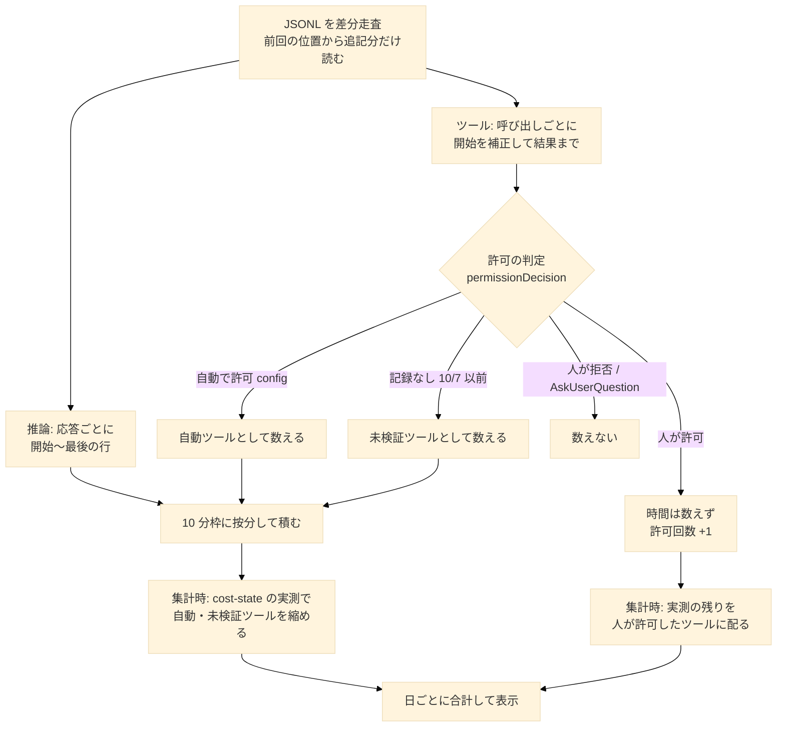
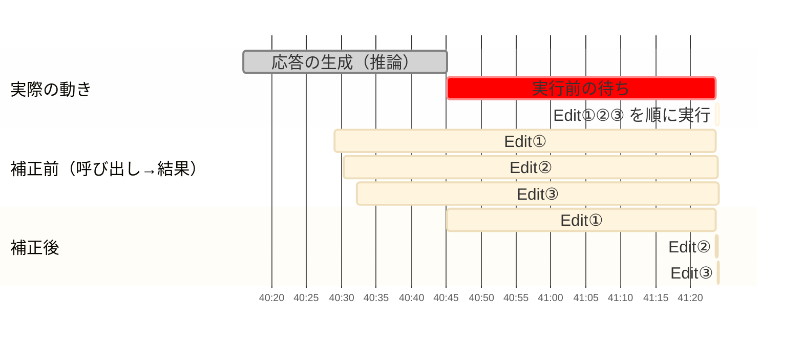

# AI 稼働時間の集計ロジック

ホームの週間カレンダーに出している「AI 稼働時間」と「許可 N」を、どのデータからどう計算しているかをまとめる。実装は `server/activity-heatmap.js`（集計）と `client/src/utils/calendar.js`（日別の合計と表示）にある。

## 目次

1. 背景
2. 結論（何を数えているか）
3. 計算の手順
4. データ源と、調べて分かったこと
5. 実測との比較
6. 既知の制約
7. 詳細リファレンス

## 1. 背景

- AI に自律的に任せられる時間を長くしたい。その指標として、AI が実際に動いていた時間（推論とツール実行）を日ごとに見る。
- 会社では Datadog の AI 稼働時間（Claude Code が OpenTelemetry で送る `api_request` と `tool_result` の `duration_ms` を、呼び出しごとに足したもの）を見ている。ただし、計測データ送信を設定していない環境の分は載らない。計測データ送信には依存させたくないので、ローカルの JSONL（`~/.claude/projects/**/*.jsonl`）だけで、Datadog と比べられる数字を出す。
- JSONL には呼び出しごとの実行時間が無く、タイムスタンプしか無い。そのため推定になる。推定の誤差は、Claude Code 自身の実測（`cost-state`）で補正する。

## 2. 結論（何を数えているか）

- **AI 稼働時間 = 推論の時間 + ツールの実行時間**。どちらも呼び出し 1 回ごとに時間を出して足す。
- **Datadog と同じく、壁時計にしない**。並列に呼んだツール、同時に動いた複数のセッション、サブエージェントの時間は、そのまま足す。そのため、1 日の合計が 24 時間を超えることがある。
- **人が関わった待ち時間は入れない**。AskUserQuestion への回答待ち、許可プロンプトの待ち、auto モードの判定待ちのこと。
- **人がツールの実行を許可した回数は、時間とは別に「許可 N」として出す**。人が許可するたびに自律が止まっているので、時間に混ぜず回数として見る。

## 3. 計算の手順

### 3.1 全体の流れ

### 3.2 推論

- 応答 1 回（`requestId`、無ければ `message.id`）ごとに 1 回数える。1 回の応答は、思考・本文・ツール呼び出しのブロックごとに別の行で書かれるので、同じ ID の行をまとめる。
- 開始は、その応答の最初の行の直前にある、人の指示かツールの結果の行の時刻。直前が別の応答の行なら、その時刻を下限にする。
- 終了は、同じ応答の最後の行の時刻。
- 1 回 10 分（`MAX_CALL_MS`）まで。
- 応答の途中にツールの結果の行が挟まっても、応答は切らない。

### 3.3 ツール

- 呼び出し（`tool_use`）1 回ごとに、結果（`tool_result`）の行の時刻までを数える。
- ツールの結果に `toolUseResult.durationMs` があれば実測なので、それを使う（WebFetch・Glob など）。
- 開始時刻は、推論との二重計上と順番待ちを除くよう補正する。

| 条件 | 開始時刻 |
|---|---|
| 結果が、その応答の最後の行より前に来た（生成中に実行された。Read などの読み取り系） | 呼び出しの行 |
| それ以外 | max(呼び出しの行, 応答の最後の行) |
| さらに Edit / MultiEdit / Write / NotebookEdit（順に実行される） | 同じ応答の、直前の結果の行以降 |

- Bash と MCP は並列に実行されることがあるので、順番待ちの補正はしない。
- 開始が結果より後になる場合は 0。
- 応答の最後の行は、次の応答の行か、人の指示などが来た時点で確定する。それまでツールの加算は保留する。更新が 10 分以上止まったファイル（完了報告で終わるサブエージェントや、強制終了した本体）は、保留中のツールを応答の最後の行で確定させて数える。

開始時刻の補正の例（1 回の応答で Edit を 3 件呼び、応答の生成後に順に実行された場合）。

### 3.4 許可の判定による扱い

ツールの結果のレコードに付く `permissionDecision` で、扱いを分ける。

| 判定 | 扱い |
|---|---|
| `source: config`（設定・権限モード・auto モードの判定で自動許可） | 自動ツールとして数える。上限なし |
| `source` が `user` で始まり、許可（`user_temporary` など） | 時間は数えない（待ちと実行を分けられない）。許可回数 +1。実行時間は 3.6 で配る |
| `source` が `user` で始まり、拒否 | 数えない |
| AskUserQuestion / ExitPlanMode | 数えない（人の回答待ち） |
| 記録なし（10/7 以前）で、本文に拒否の定型文（`doesn't want to proceed`） | 数えない |
| 記録なし（10/7 以前）で、それ以外 | 未検証ツールとして数える。3.5 で縮める |

### 3.5 実測に合わせて縮める

自動ツールと未検証ツールのタイムスタンプの差には、AI が動いていない時間が入る。

- auto モードの判定待ち（1 回あたり 1〜2 秒）
- 10/7 以前の許可待ち

これらは、`cost-state` の実測にも、Datadog の `tool_result` の時間にも入っていない。そこで、終了したプロセスの実測に合わせて縮める。

1. `cost-state` のプロセス（`[startTime, startTime + totalDuration]`）ごとに、本体の自動・未検証ツールの区間の和集合 U を出す。実測は並列の重なりを 1 回しか数えないので、比べる側も重なりを 1 回にする。
2. U が実測（`totalToolDuration`）より大きければ、各呼び出しを f = 実測 / U 倍に縮める。呼び出しごとに足す数え方は保つ。U の方が小さいときは、増やしはしない。
3. プロセスの範囲が重なる場合（resume で同じ JSONL に 2 つのプロセスが書いた場合）は、最も内側（後から起動した方）の 1 つにだけ割り当てる。
4. `cost-state` の無いプロセス（動いている最中、または強制終了）のツールは次のとおり。
    - 自動ツール: そのまま数える。
    - 未検証ツール: 1 回 10 分まで。
5. サブエージェントの JSONL のツールは縮めない（どのプロセスの実測に対応するか取れないため）。

### 3.6 人が許可したツールの実行時間

- 時間の記録には、許可した時刻が残らない。そのため、タイムスタンプの差（許可待ち＋実行）は使わない。
- `cost-state` のプロセスごとに、R = max(0, 実測のツール合計 − そのプロセスの自動ツール時間（縮めた後）) を出す。
- R を、そのプロセスで人が許可したツールに、間隔（結果 − 呼び出し）の比で配る。1 件あたり、自分の間隔までにする。
- 配った時間は、結果の直前（`[結果 − 配分, 結果]`）に積む。許可の後に実行され、結果が書かれるため。

### 3.7 日別の合計

- 時間は、開始から終了までがまたがる 10 分枠に按分して積む（日付の境目をまたぐ実行も正しく分かれる）。
- サブエージェントの時間は、親のセッションに足す。
- クライアントは、表示している週の枠をローカル日付で合計する（`dailyBusyMs` / `dailyApprovals`）。共有モードで隠したセッションは含めない。

## 4. データ源と、調べて分かったこと

| データ | 中身 | 使い方・注意 |
|---|---|---|
| assistant の行の `timestamp` | 応答のブロックが書かれた時刻 | 推論とツールの開始・終了に使う |
| ツールの結果の行の `timestamp` | 結果が書かれた時刻 | ツールの終了に使う |
| `permissionDecision`（ツールの結果の行） | 許可・拒否と、その出どころ（`source`）・理由（`reasonType` など） | Claude Code v2.1.293（2026-10-08）以降にだけある。判定した時刻は入っていない |
| `toolUseResult.durationMs` | 一部のツールの実行時間 | WebFetch・Glob など、ごく一部にしか無い |
| `cost-state` | プロセスの累計（`totalAPIDuration`・`totalToolDuration`・`totalDuration`・`startTime`） | プロセス終了時に書かれる。待ち時間を含まない実測。並列の重なりは 1 回しか数えない。サブエージェントの分も一部入るらしい |
| `system:turn_duration` | ターンの所要時間 | AskUserQuestion の回答待ちなどを含むので使わない |

調べて分かったこと。

- **許可した時刻はどこにも残らない**。許可プロンプトを 20 秒放置してから許可する実験では、呼び出しの行から結果の行までの間に、何のレコードも書かれなかった。許可の判定は結果の行に付くだけ。
- **`cost-state` は待ち時間を含まない実測**。上の実験では、呼び出しから結果まで 25.2 秒のうち、`totalToolDuration` は 5.2 秒（実際にコマンドが動いた時間）だった。
- **`cost-state` は並列の重なりを 1 回しか数えない**。BigQuery の MCP を並列に呼んだプロセスでは、実測 107 秒に対して、呼び出しごとの合計が 410 秒、重なりを 1 回にした値が 116 秒だった。
- **resume したプロセスは、前のプロセスの `cost-state`（`startTime` と合計）を引き継いで書き直す**。たいていは累積して増えていくが、合計が全く増えないまま書き直されることがある（391 ファイル中 3 回）。この場合、後のプロセスの分は入っていないので、合計が最後に増えた書き込みの直前で範囲を打ち切り、それより後は `cost-state` の無いプロセスとして扱う。
- **10/7 以前は、auto モードでも人への確認待ちが多かった**。`git switch` に 145 秒かかるなど、実行にしては長すぎる間隔が多く、呼び出しごとの合計が実測の約 2 倍だった。
- **auto モードの判定待ちは、判定の API 呼び出しが JSONL に記録されない**。直接は測れないので、`cost-state` との差で除く。

## 5. 実測との比較

推定を、同じ範囲の `cost-state` と比べた値（実測のある 393 プロセス、本体とサブエージェントの合計）。

| 区分 | 推論 | ツール |
|---|---|---|
| 10/8 以降（265 プロセス） | 0.98 倍 | 1.14 倍 |
| 10/7 以前（128 プロセス） | 0.98 倍 | 1.25 倍 |
| 全体 | 0.98 倍 | 1.19 倍 |

- ツールが 1.0 倍にならないのは、呼び出しごとに足しているため（実測は並列の重なりを 1 回しか数えない）。Datadog と同じ数え方を選んだ結果で、意図どおり。
- 補正を入れる前は、ツールが 1.45 倍だった。主な原因は、並列の重なり・応答の生成待ちと順番待ち・auto モードの判定待ち・10/7 以前の確認待ち。

## 6. 既知の制約

- **動いている最中のセッションは縮められない**。`cost-state` は終了時に書かれるため。セッションを閉じた後の集計で、値が少し下がる。人が許可したツールの実行時間も、終了するまで 0。
- **10/7 以前の大半は実測が無い**。判定記録の無いツール 54,040 件のうち 43,369 件は、`cost-state` を書かずに終わったプロセスのもの。これらは 1 回 10 分の上限付きの推定のまま。
- **縮めるときは、プロセス内の全呼び出しを同じ比率で縮める**。合計は実測に合うが、長い待ちを含んでいた呼び出しは、縮めた後も大きく残る。
- **直近のツールは、応答の終わりが確定するまで反映が遅れる**。
- **サブエージェントのツールは縮めない**。

## 7. 詳細リファレンス

### 10 分枠の列（`slots` の値）

| 列 | 中身 |
|---|---|
| 0 | 人の発言数 |
| 1 | 応答数 |
| 2 | 調査系ツール数（Read / Grep / Glob / WebFetch / WebSearch） |
| 3 | 編集系ツール数（Edit / MultiEdit / Write / NotebookEdit） |
| 4 | AI 稼働 ms（`SLOT_BUSY`） |
| 5 | 自動ツール ms（`SLOT_AUTO_TOOL`。3.6 の差し引き用） |
| 6 | 人の許可回数（`SLOT_HUMAN_APPROVALS`） |
| 7 | 縮める対象のツール ms（`SLOT_SHRINKABLE_TOOL`。3.5 用） |

### 定数

| 名前 | 値 | 意味 |
|---|---|---|
| `SLOT_MS` | 10 分 | 集計の枠 |
| `MAX_CALL_MS` | 10 分 | 推論 1 回の上限。`cost-state` の無い未検証ツールの上限 |
| `STALE_FILE_MS` | 10 分 | 更新が止まったファイルの保留を確定させるまでの時間 |
| `SEQUENTIAL_TOOLS` | Edit / MultiEdit / Write / NotebookEdit | 順番待ちの補正をかけるツール |

### キャッシュ

- `<dataDir>/activity-heatmap.json` に、ファイルごとの集計と再開用の状態を持つ。2 回目以降は、追記された分だけを読む。
- 再開用の状態は、`busy`（進行中の応答・未解決のツール・保留中のツール・各区間）、`costStates`、`lastConvMs`。
- 形式を変えたら、`CACHE_VERSION` を上げる（上げないと古いキャッシュがそのまま使われ、再走査されない）。
- 初回の全走査は約 23 秒かかる。サーバーは listen した後に、裏で 1 回だけキャッシュを温める（`warmActivityCache()`）。
